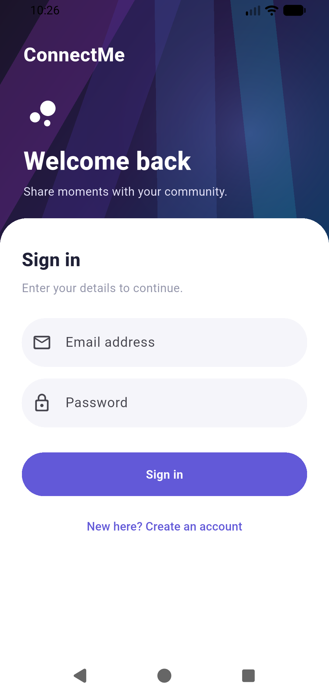
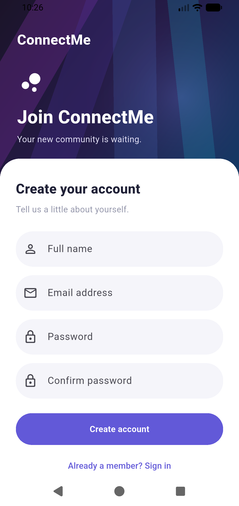
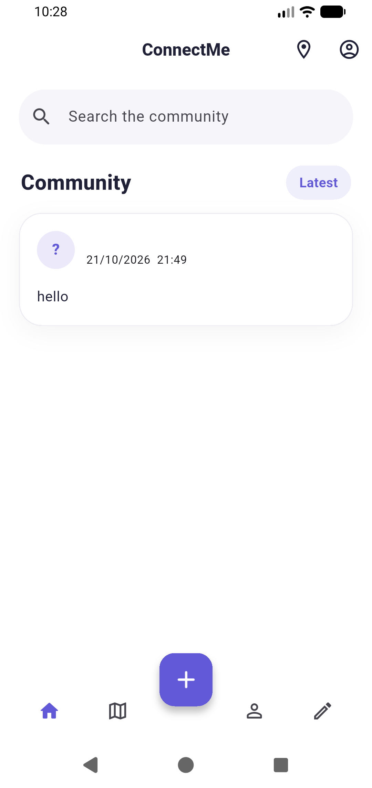
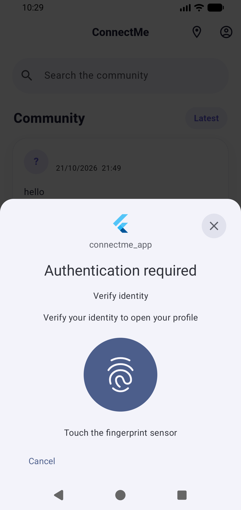
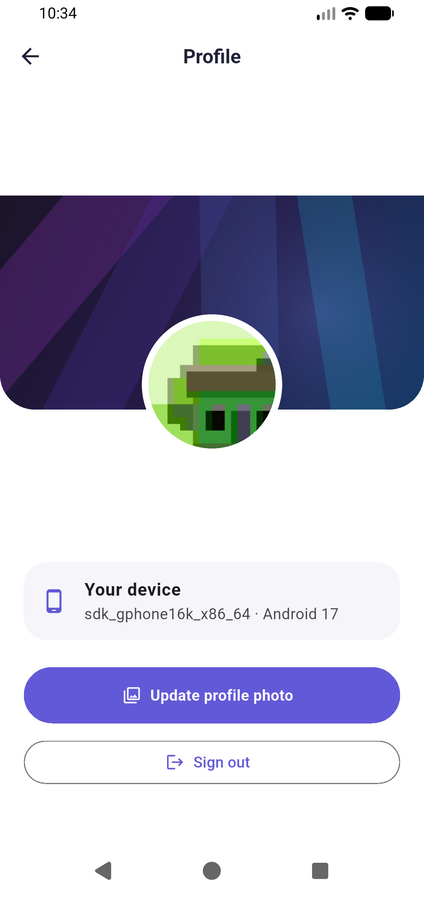
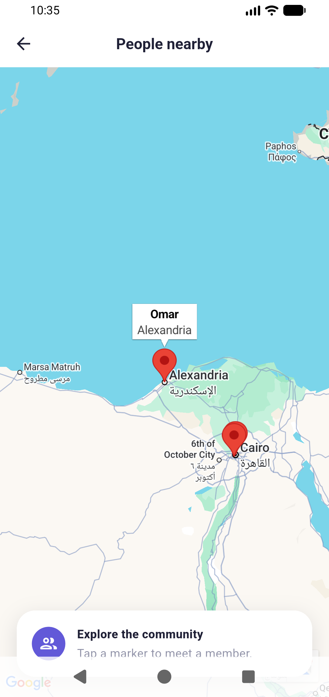

# ConnectMe Community App

ConnectMe is a Flutter community app with Firebase email sign-in, a live Firestore post feed, a biometric-gated profile, gallery photos, device information, and a map of members. The Android beta is distributed through Firebase App Distribution.

The visual design follows the [Social App Free UI Kit](https://www.figma.com/community/file/1074560321292383928/social-app-free-ui-kit): a violet and white palette, rounded inputs and cards, an angular gradient header, and a raised central compose button. The app adapts that visual language to its implemented community features.

## Features

- Email and password sign-up with full name, email, password, and confirmation validation. Firebase Auth keeps the session across app restarts.
- Real-time Firestore feed with post author, text, timestamp, and a new-post form.
- Profile protected by device biometrics. The profile includes name, email, device model, OS version, and a gallery photo.
- Google Map with members in Cairo, Alexandria, and Giza. Marker info windows show each member's name and city.

## Screenshots

Captured from the Android emulator.

| Login | Sign Up |
| --- | --- |
|  |  |

The Home Feed screenshot shows a post loaded from Firestore.



The profile gate uses the device's biometric prompt.



| Profile | Community Map |
| --- | --- |
|  |  |

## Architecture

```text
Presentation (screens, widgets, AuthCubit, PostCubit, ProfileCubit)
    ↓
Domain (entities, repository contract, GetPosts, CreatePost)
    ↓
Data (JSON models, Firestore and local data sources, repository)
    ↓
Services (Firebase Auth, Firestore, biometrics)
```

`injection.dart` registers repositories, use cases, and Cubits with GetIt. `FirestoreService.instance` is the Singleton used by the app. `PostDataSourceFactory` chooses a Firestore or local data source; the repository caches fetched posts in memory and shows that cache if the live stream fails. `UserBuilder` constructs profiles from the fields supplied during sign-up. Each screen, Cubit, model, repository, use case, and widget has its own Dart file.

Profile photos are compressed before upload and stored as Base64 in the user's Firestore document. The app limits the selected image to 650 KB to stay below Firestore's document size limit. Firestore rules in `firestore.rules` restrict profile access to the owner and require post authors to match the signed-in user.

## Setup

1. Install Flutter and run `flutter pub get`.
2. Configure a Firebase project with Email/Password Authentication and Cloud Firestore. The project already contains generated FlutterFire options and Android `google-services.json` for project `connectme-efaf1`.
3. Put the Google Maps API key in the ignored `.env` file as `google_maps=YOUR_KEY`. Android Gradle reads it into the map manifest entry. Restrict the key to the app's package and signing certificate in Google Cloud.
4. For iOS, create ignored `ios/Flutter/Maps.xcconfig` containing `GOOGLE_MAPS_API_KEY=YOUR_IOS_KEY`; `AppDelegate.swift` passes it to Google Maps. Use a separate key restricted to the iOS bundle ID and Maps SDK for iOS, and add the iOS Firebase app configuration before building on a Mac. The Android Maps key is restricted to Android and will not work on iOS.
5. Run `firebase deploy --only firestore:rules --project connectme-efaf1`, then `flutter run`.

Android uses `INTERNET` for Firebase and map tiles, and `USE_BIOMETRIC` for profile verification. iOS declares Photo Library and Face ID usage descriptions. The gallery picker requests photo access through the platform picker. The app does not request location access because map markers are predefined.

## Beta distribution

On **21 October 2026**, `flutter analyze` passed with no issues and `flutter build apk --release` produced `build/app/outputs/flutter-apk/app-release.apk` (54 MB), version **0.2.1 (3)**, SHA-256 `2a392087a064af5ed268ac6d8069d66738228c0ddda135a5ce7081716afc4a81`. Firestore rules deployed successfully to `connectme-efaf1`.

The following command uploaded the APK and assigned the release to two testers:

```sh
firebase appdistribution:distribute build/app/outputs/flutter-apk/app-release.apk \
  --app 1:1024765068666:android:759640172b3636270482c3 \
  --testers "$TESTER_EMAIL_1,$TESTER_EMAIL_2" \
  --release-notes 'ConnectMe 0.2.1: profile photo upload fix for existing accounts.' \
  --project connectme-efaf1 --non-interactive
```

Firebase CLI reported that version 0.2.1 (3) was distributed to both testers.

| Tester | Assigned to release | Invitation received | Installed |
| --- | --- | --- | --- |
| Tester A | Yes | Previous invitation confirmed | Pending |
| Tester B | Yes | Previous invitation confirmed | Pending |

The CLI confirms assignment to the new release. Both initial invitations arrived; receipt of the new release and installation have not yet been confirmed on either device. The release was built with the starter project's debug signing configuration; use a dedicated release keystore for production and add its SHA-1 fingerprint to the Maps key restriction.

